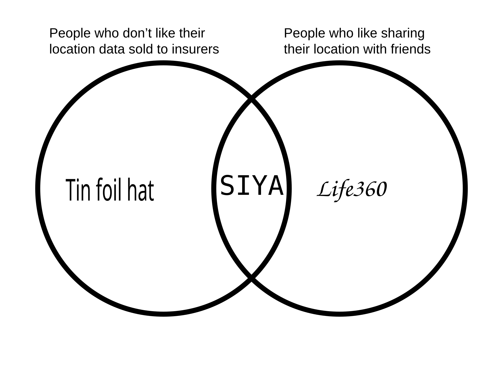

I want to share my location with my friends, and many of them want to share theirs with me.

Why do location sharing apps all suck?
- Life360: Sells all your data to advertisers and insurers. Ever wonder why their car crash detection is so advanced compared to the rest of the program?
- Apple Find My: now he sings (iOS), now he sobs (Android)
- Google Maps Sharing: NUH UH
- OwnTracks/Traccar/Dawarich/Overland/Home Assistant Companion/GPSLogger/Grid: has anyone ever actually figured out how to setup any of these?

# SIYA: Single(s) In Your Area
Self-hosted location sharing app for you and your friends :)

In terms of architecture, the backend is in Go and the frontend in SvelteKit using TypeScript. It connects to a Traccar server and exposes a website that acts as the viewing end for clients.

Advantages
- You alone control the data
- No ads or subscriptions
- iOS and Android compatible*

Disadvantages
- Requires a server
- Requires both an app and a website (which can be added as a web app) to function properly. One for sending, one for viewing. There is only hate in my heart for the iOS app store.

# Roadmap
Backend:
- [X] get devices list from Traccar API (REST)
- [X] get positions list from Traccar API (REST)
- [ ] store live devices/positions in memory
- [ ] add live updates using Traccar API Websockets
- [ ] expose API with Chi (REST)
- [ ] expose live API with SSE/websockets
- [ ] add Siya users
- [ ] add Siya authentication
- [ ] get device history from Traccar API (REST)
- [ ] add circles

Frontend:
- [ ] setup SvelteKit environment
- [ ] connect to backend
- [ ] display on map
- [ ] live updates
- [ ] bells and whistles
